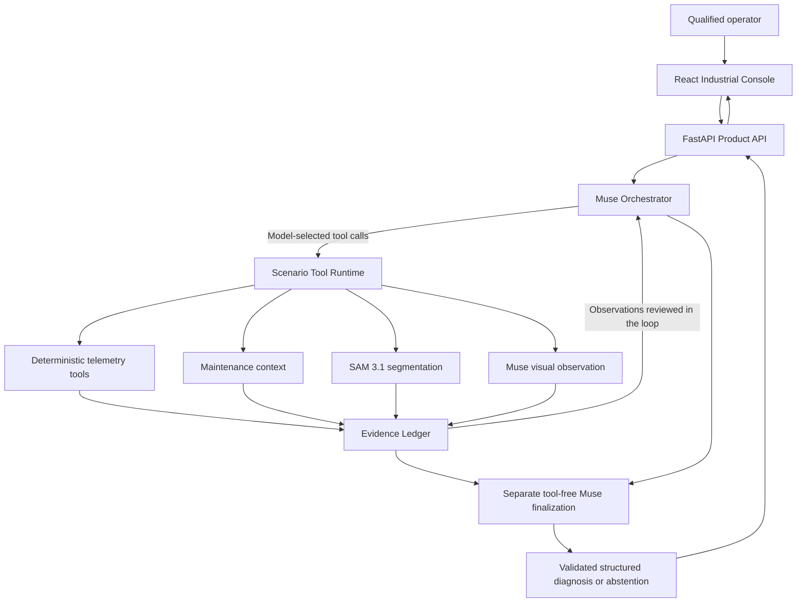
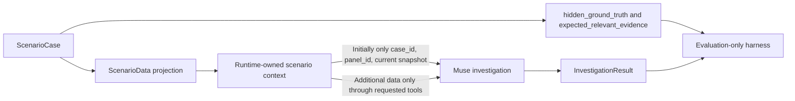

# GridProbe architecture

GridProbe separates evidence acquisition from interpretation. The current product uses deterministic scenario files and in-memory investigation state; hardware adapters are future work.

## Product and investigation flow

The tool branches are available operations, not a mandatory execution sequence. Muse selects which evidence to request. Missing images yield structured unavailable results; neither visual tool runs automatically. Current snapshot retrieval returns measurements without adding a new ledger record. Other successful evidence-producing requests create typed records, including completed empty retrievals or zero-match SAM results.

## Evaluation-data isolation

`ScenarioCase.to_scenario_data()` drops evaluation annotations before runtime construction. The runtime accepts exactly `ScenarioData`, rejecting a `ScenarioCase` subclass. It retains a private copy. **The complete ScenarioData is not passed to the agent:** initial context contains only IDs and current telemetry. Full history, maintenance records, and images are not inserted into the initial conversation. Raw image contents go only to the dedicated visual provider when its tool is requested.

Evaluation JSON files and reports may contain labels for offline scoring. They are repository evaluation artifacts, never public product responses or model inputs. This is application-context isolation, not a claim that labels in this repository are inaccessible to someone reading its files.

## Role boundaries

| Layer | Responsibility | Boundary |
| --- | --- | --- |
| Deterministic Python | Retrieve measurements; calculate phase imbalance and signed temperature trend | No diagnosis or arbitrary electrical safety thresholds |
| SAM 3.1 | Localize components; return boxes and validated mask metadata | Geometry does not establish condition or cause |
| Muse visual observation | Describe objective visible properties and image quality | No electrical diagnosis or safety classification |
| Muse GridProbe agent | Choose evidence, assess sufficiency, combine independent observations, reason about causes | Diagnose only when supported; otherwise request evidence or abstain |
| Evaluation harness | Compare final results with evaluation-only annotations | Does not influence an investigation's tool choices or diagnosis |

The SAM provider uses streamed `POST /v1/responses` with `sam-3.1` and official `meta_sam_parser`. The observation provider uses `muse-spark-1.3` Chat Completions with a user image content part and Pydantic parsing. Both use the existing Meta credential on the server. Muse vision receives the image and requested component, not a suggested fault or evaluation answer. [Vision details](vision.md) document validation and lexical observation guards.

## Orchestration and finalization

The orchestrator begins with the developer prompt and safe initial incident context. It passes seven function schemas to Muse, validates every returned tool name and argument batch against a fixed allowlist, executes requests through the existing runtime, and appends one result per tool-call ID.

The eight-turn limit bounds investigation. Tools in a batch execute in order. At a natural stop or the limit, a separate Muse request receives the complete investigation conversation and serialized ledger, with no tools. Limit termination explicitly warns against unsupported certainty.

Final output must parse as `DiagnosisResult`; free-form text cannot bypass validation. Unknown cited IDs are rejected. Result states are `DIAGNOSIS_READY`, `NEEDS_MORE_EVIDENCE`, and `NO_ACTIONABLE_DIAGNOSIS`. The contract includes likely fault, risk, confidence, references, reasoning summary, recommended inspection, and missing evidence. Confidence is not calibrated probability.

## Evidence and trace

The ledger preserves insertion order, rejects duplicate IDs, and returns independent copies. Successful distinct evidence-producing requests receive `EV-001`, `EV-002`, and so on. Identical requests reuse cached evidence within one investigation. Numerical facts, retrieved context, segmentation, and visual observations remain separate records. A Muse observation can link existing SAM IDs for the same normalized component without requiring SAM first.

Trace events record model responses, tool calls, tool results, evidence IDs added, and finalization in chronological order. The public API replaces raw assistant content with safe event summaries. It does not expose private chain-of-thought. The dashboard displays the completed trace after the synchronous investigation request finishes.

## Product boundary

| Route | Public behavior |
| --- | --- |
| `GET /health` | Backend health |
| `GET /api/scenarios` | Four allowlisted primary cases: IDs, initial telemetry, image availability |
| `POST /api/investigations` | New runtime/ledger; safe case details, trace, evidence, diagnosis, usage, and cost |
| `GET /api/scenarios/{case_id}/image` | Validated raster for an allowlisted primary case, if available |

Scenario history is returned to the console after an investigation for plotting; this does not make it initial agent context. Evaluation annotations, credentials, provider internals, and raw assistant reasoning are excluded. Image paths cannot be supplied by tool arguments; the resolver rejects traversal and symlink escape outside demo assets.

## Usage, verification, and scope

Reported usage includes Muse investigation, finalization, and image-observation requests. Reasoning is a subset of output, not an extra charge. Missing usage remains partial; SAM charges are not estimated. [Evaluation](evaluation.md) defines costs and scoring denominators.

Live dashboard smoke tests cover CASE-002 and CASE-004. SAM and Muse vision have mocked automated coverage; CASE-001's real image is not bundled and no live vision success is claimed. The present data source is simulated telemetry. Serial, MQTT, Modbus, gateways, thermal cameras, and other physical domains are roadmap work.
